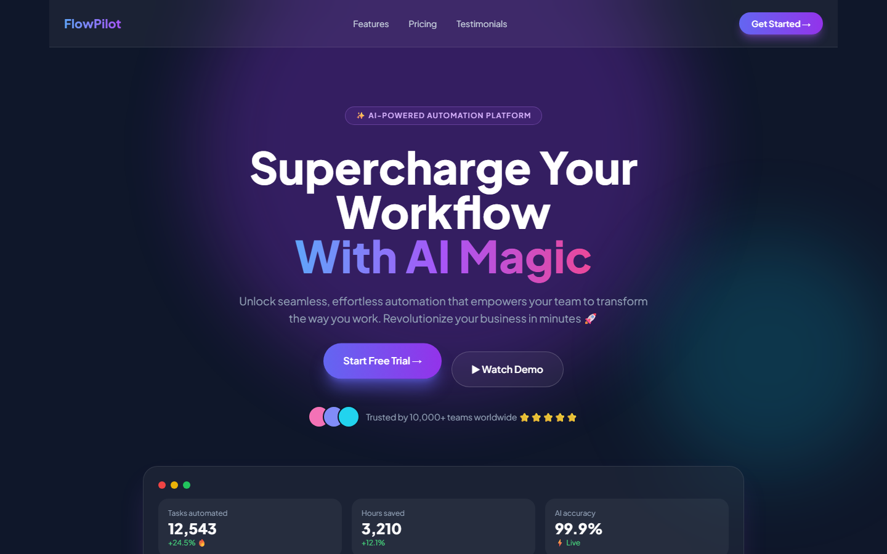
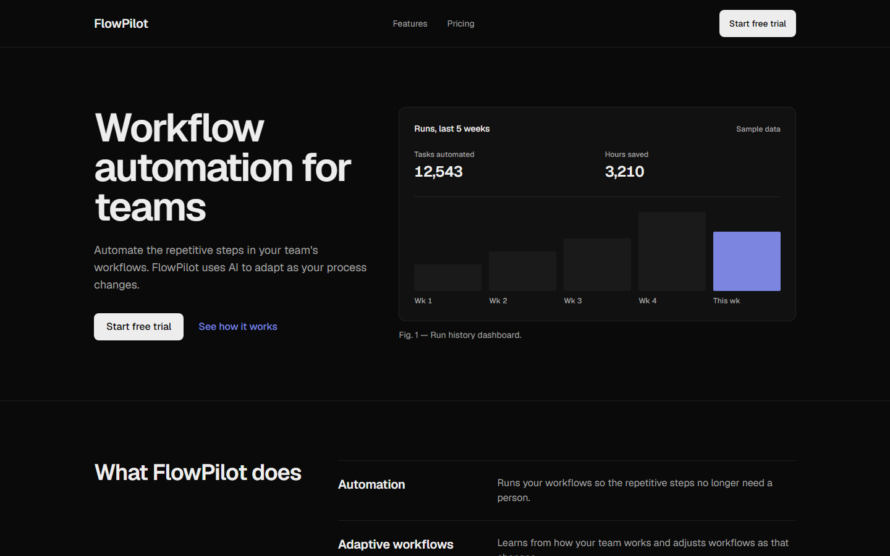
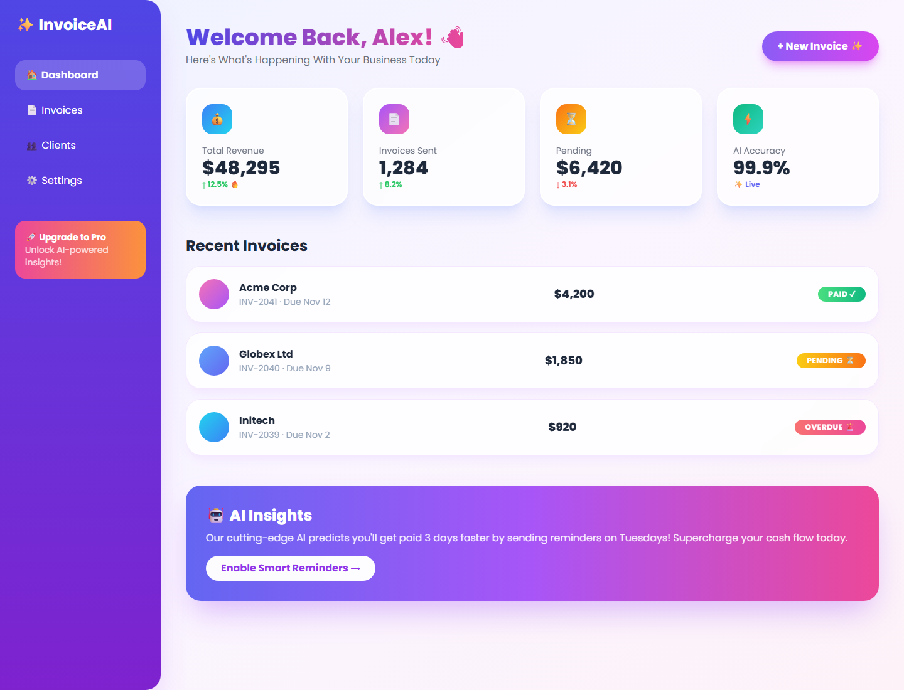
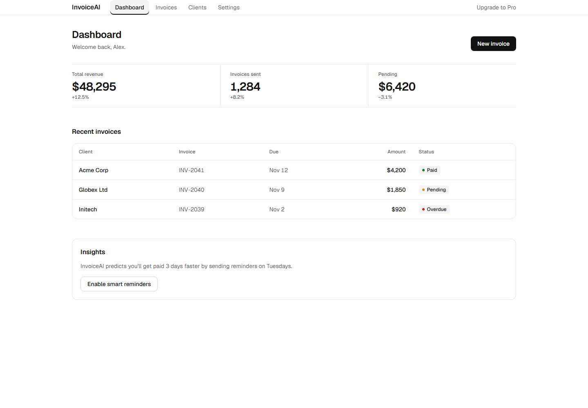
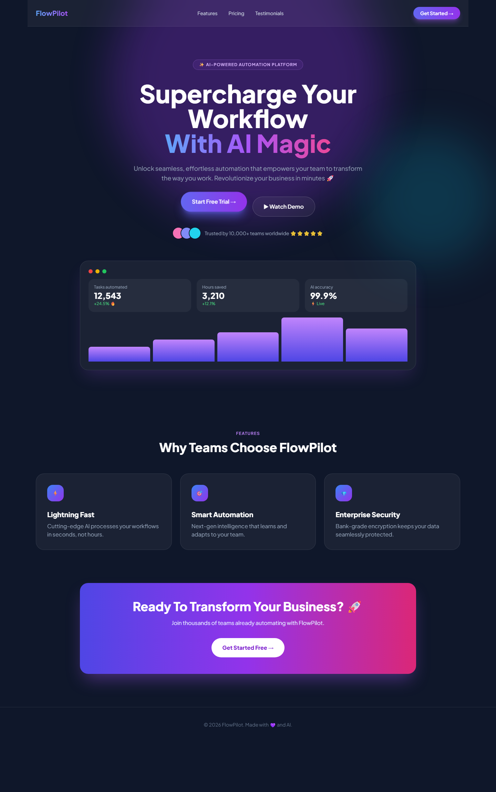
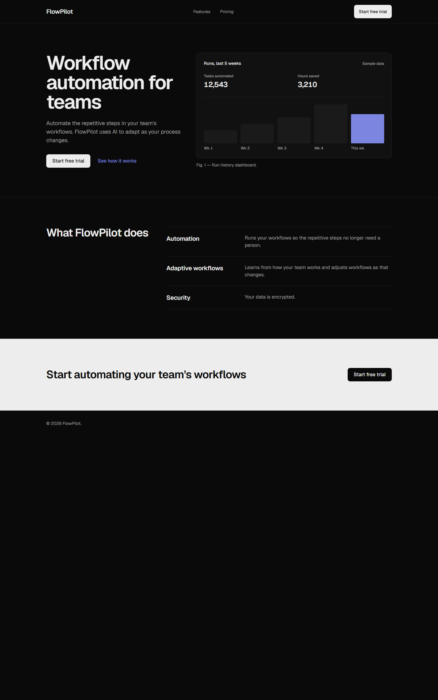
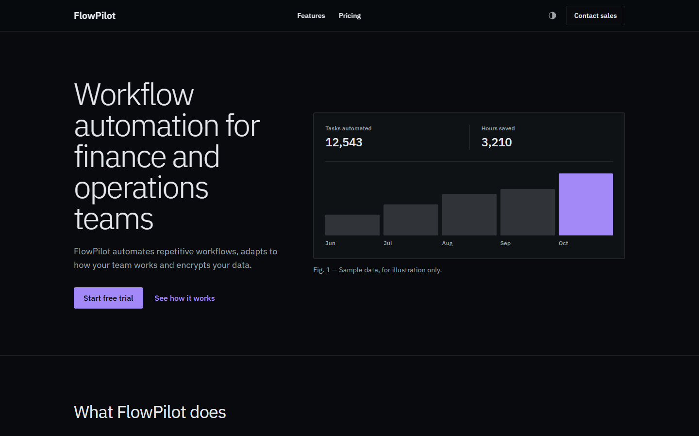
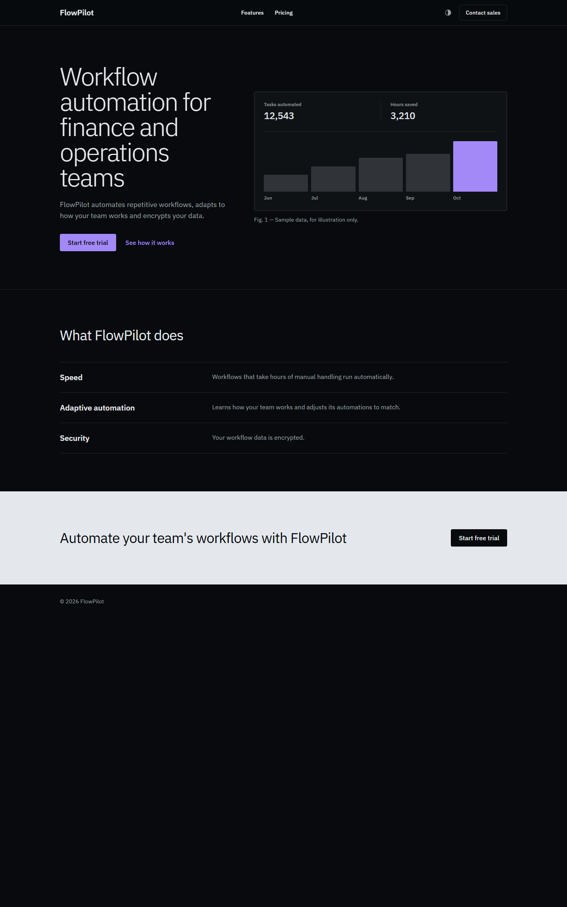
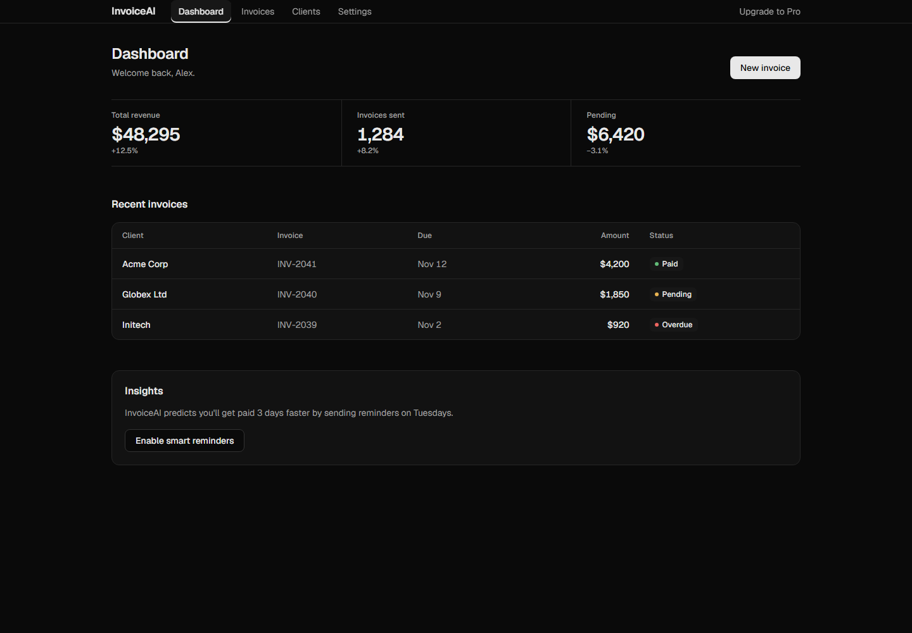

# deslop

**A Claude Code skill that turns AI-generated "slop" websites into MNC-grade design.**

You know the look: a blue-to-purple gradient headline, a glowing pill CTA, a "✨ AI-Powered" badge, three identical icon cards, frosted-glass everything, emoji in the stats. Every Lovable, v0 and Bolt site ships it by default. `deslop` audits a page, picks a design direction the way a UI/UX department head would, and ports colour, type, components, radius, borders, motion and copy to the standard of Stripe, Linear and IBM.

| | Before | After |
|---|---|---|
| Marketing page |  |  |
| App dashboard |  |  |

---

## Contents

- [The core finding](#the-core-finding)
- [Install](#install)
- [Use it](#use-it)
- [What the skill does, step by step](#what-the-skill-does-step-by-step)
- [The tools (usable without Claude)](#the-tools-usable-without-claude)
- [Live demo, page by page](#live-demo-page-by-page)
- [What's in the box](#whats-in-the-box)
- [How it was built and tested](#how-it-was-built-and-tested)
- [Limits](#limits)

---

## The core finding

**Blue and purple are not the problem. The treatment is.**

We measured real AI-built landing pages against Linear and Stripe with the bundled audit script:

| Site | Slop score (0–100) | Blue/violet share of colour | Gradient text | Coloured glows | Library icons | Emoji |
|---|---|---|---|---|---|---|
| AI tutor landing (Lovable) | 94 | 82% | 10 | 17 | 30 | 2 |
| AI sales-coach landing (Lovable) | 74 | 93% | 1 | 1 | 51 | 1 |
| "AI SaaS platform" (v0) | 99 | 59% | 3 | 25 | 102 | 18 |
| **Linear** | **11** | 49% | 0 | 0 | 0 | 0 |
| **Stripe** | **39** | **97%** | 0 | 3 | 0 | 1 |

Stripe is 97% indigo and still reads as a $90B company. It gets there with no gradient text, 4–6px radii, one licensed typeface, no icon confetti and no emoji. So deslop doesn't just recolour. It removes the *tells* and imposes a *system*.

Another finding: the three classic "AI button" colours **fail WCAG AA with white text**. violet-500 scores 4.23, indigo-500 4.47 and blue-500 3.68, against a 4.5 minimum. Slop isn't only ugly; it is often inaccessible.

The full catalogue of the 24 tells is in [`deslop/references/slop-catalog.md`](deslop/references/slop-catalog.md).

---

## Install

You need [Claude Code](https://claude.com/claude-code) (CLI, desktop app, or IDE extension) and Node.js 18 or later for the helper scripts.

### Option 1: personal skill (works in every project)

**macOS / Linux**
```bash
git clone https://github.com/<your-user>/deslop.git
mkdir -p ~/.claude/skills
cp -r deslop/deslop ~/.claude/skills/deslop
```

**Windows (PowerShell)**
```powershell
git clone https://github.com/<your-user>/deslop.git
New-Item -ItemType Directory -Force "$HOME\.claude\skills" | Out-Null
Copy-Item -Recurse deslop\deslop "$HOME\.claude\skills\deslop"
```

### Option 2: project skill (shared with your team via git)

Copy the folder into the repo you want to deslop:
```bash
mkdir -p .claude/skills
cp -r /path/to/deslop/deslop .claude/skills/deslop
```

### Check it loaded

Start a **new** Claude Code session (skills load at session start) and type `/deslop`. It should appear in the slash-command list.

To update later, `git pull` in your clone and copy the folder again. The installed copy does not update itself.

---

## Use it

Open Claude Code in the project you want to fix, then either:

```text
/deslop
```

or just describe the problem. The skill triggers on phrases like:

- "this looks AI-generated / cheap / generic / templated"
- "too purple", "looks like every Lovable site"
- "make it look premium / enterprise / Fortune-500 / Stripe-level"

### Useful things to tell it

The more facts you give it, the better the result, because it **never invents** customers, stats or claims.

| Tell it | Why it matters |
|---|---|
| Your **brand colour**, and whether it must stay (`"brand is #8B5CF6, keep it"`) | It keeps the hue but deepens and disciplines it, instead of replacing it |
| **Who buys** the product (`"sold to finance teams through procurement"`, `"self-serve for freelancers"`) | It picks the house style: Enterprise, Product-mono or Editorial |
| Which **stats and testimonials are real** | Unverified ones get removed or flagged |
| The **page type** (marketing site vs app dashboard) | App screens get a denser type scale and app patterns |
| A **URL or dev-server port** | It can run the live audit in a browser and screenshot before and after |

### Example prompts

```text
/deslop our landing page in src/app/page.tsx. Brand colour is #6366F1 and must stay.
We sell to enterprise IT teams.
```
```text
The dashboard in src/pages/dashboard looks like a v0 template. Make it Linear-grade.
No brand colour yet. Real users are freelancers.
```
```text
Audit http://localhost:3000 for AI slop and give me the ranked list before changing anything.
```

---

## What the skill does, step by step

1. **Audit.** It runs the static scanner over your source and, if a browser is available, the live fingerprint on the rendered page. Then it screenshots the page and gives you a ranked list of the loudest tells with counts.
2. **Decide.** It picks **one** house style, using a tie-break based on how the product is bought:

   | Style | Feels like | Picked when |
   |---|---|---|
   | **A. Enterprise** | IBM, SAP, Atlassian | sales-led to IT, finance, regulated industries |
   | **B. Product-mono** | Linear, Vercel, Raycast | self-serve by any business buyer (devs, SMBs, freelancers) |
   | **C. Editorial** | Stripe, Notion, Airbnb | bought by individuals; brand-led consumer |

3. **Port.** It works source-first, in this order:
   1. **Tokens.** A palette generated from your brand colour, with a radius scale and shadow and motion tokens.
   2. **Type.** One family per style, sentence case, negative tracking on large sizes, a 65-character measure.
   3. **Loud tells.** Removes gradient text, gradients, glows, blobs, glass, looping animation and hover lifts.
   4. **Colour placement.** A colour budget (90–96% neutral), an accent whitelist, three text levels and real interaction states.
   5. **Components.** The least decorated object that fits the content. Rows before cards, tables for records, an inline stat row instead of stat cards. Plus exact radius, border-width and control-height specs.
   6. **Stock sections.** Hero, features, social proof, pricing, CTA bands, fake dashboards, and app screens.
   7. **Copy.** Removes buzzwords and emoji, and uses only facts from your project.
   8. **Leftovers.** Template badges, dead links and lorem text get flagged, never invented.
4. **Verify.** It re-scans, re-audits and re-screenshots, then runs a **13-point department-head review gate**. The final report gives before and after scores and lists what it flagged but deliberately didn't change.

---

## The tools (usable without Claude)

All three scripts have zero dependencies. Run them from the skill folder.

### 1. Static scanner: `slop-scan.mjs`

Finds the tells in your source as `file:line` entries, each with a fix.

```bash
node deslop/scripts/slop-scan.mjs src/
node deslop/scripts/slop-scan.mjs src/ --json      # machine-readable
node deslop/scripts/slop-scan.mjs --self-test
```

Sample output:
```text
[!!!] gradient-text x2  ->  Solid foreground headline; hierarchy via size/weight, never gradient text.
   src/app/page.tsx:16  bg-clip-text text-transparent
[!!!] failing-default-accent x1  ->  Tailwind 400/500 accents fail 4.5:1 with white text; use the derive-palette.mjs --primary.
[!!] multiple-accent-hues x1  ->  One accent hue; everything else neutral or semantic.
   purple + cyan + blue + indigo + pink
...
111 tells, weighted 223. Full AI-slop: run the deslop port.
```

It checks 29 patterns (26 per line, 3 project-wide):
- gradient text and blue/purple gradients
- coloured glows, blur blobs and glassmorphism
- looping animation and hover lifts
- tinted dark backgrounds and lavender washes
- stock fonts, oversized radius and pill buttons
- thick borders, extra-bold weights and Title Case headings
- eyebrows, sparkle badges, emoji, buzzwords and "AI-powered"
- vanity stats, avatar stacks and fake window chrome
- failing default accents and hard-coded hex values
- and, project-wide, **mixed grey families**, **multiple accent hues** and **radius sprawl**

### 2. Palette generator: `derive-palette.mjs`

One brand colour in, a full accessible light and dark token set out, computed in OKLCH.

```bash
node deslop/scripts/derive-palette.mjs "#8B5CF6" C              # brand purple, Editorial style
node deslop/scripts/derive-palette.mjs none B --format=oklch    # no brand, Product-mono, Tailwind v4
node deslop/scripts/derive-palette.mjs "#2563EB" A --format=hsl # shadcn v3 channel format
```

What it does:
- keeps your **hue**
- caps the **chroma** per style, which takes the neon out
- deepens the **lightness** until white text passes 4.5:1
- builds a tinted neutral ramp
- designs dark mode separately instead of inverting the light one

It prints these shadcn-compatible variables:

| Group | Variables |
|---|---|
| Core | `--background`, `--foreground`, `--card`, `--popover`, `--muted`, `--border`, `--input`, `--ring` |
| Primary | `--primary`, `--primary-hover`, `--primary-active`, `--primary-subtle*` |
| Other fills | `--secondary`, `--accent`, `--disabled-foreground` |
| Status | `--destructive`, `--success`, `--warning`, plus 4.5:1-safe `*-text` variants |
| Charts | `--chart-1..4` |
| Radius | `--radius-sm/md/lg/xl` |

It finishes with a **contrast report of 28 checks**:
```text
/* deslop palette: style C, brand #8B5CF6 -> oklch(0.61 0.219 293) */
:root {
  --primary: #5c39a9;            /* was a neon #8B5CF6, which fails AA with white text */
  --primary-foreground: #ffffff;
  ...
/* ok   light primary-foreground on primary: 8.04 (min 4.5) */
/* ok   dark  muted (hover) visible on card: 1.13 (min 1.05) */
```

### 3. Live fingerprint: `slop-audit.js`

Paste the file's contents into the browser DevTools console on any rendered page. It is read-only. It returns:

```json
{
  "slopScore": 93, "verdict": "slop",
  "budget": { "accentAreaPct": 13.2, "chromaticHueFamilies": ["indigo/violet","blue","red/pink","green"], "distinctRadii": 2 },
  "gradientText": 2, "coloredGlowShadows": 4, "backdropBlur": 6, "emoji": 16, "buzzwords": ["seamless","unlock", "..."]
}
```

**Verdicts:** `clean` below 25, `borderline` 25–49, `slop` 50 and up.

**Calibration:** Linear 11, Stripe 39, and Lovable/v0 pages 74–99. `budget` reports the colour budget and radius count. These aren't in the score, so the calibration holds.

---

## Live demo, page by page

Every "after" page below was produced by a **fresh Claude agent that had only this skill to go on**. Nobody hand-tuned them. All source pages are in [`examples/`](examples/). Open any HTML file directly in a browser.

### Demo 1: marketing page, no brand colour → Style B (Product-mono)

**Brief:** FlowPilot, a workflow-automation SaaS. No brand constraint.

**Before:** [`examples/slop.html`](examples/slop.html)



What's wrong:
- **Hero:** a navy-purple "deep space" background with violet and cyan blur blobs, and a "Supercharge Your Workflow With AI Magic" headline in Title Case with a gradient word.
- **Pill elements:** a `✨ AI-POWERED` pill badge, and a gradient pill CTA with a glow and a bouncing animation.
- **Fake proof:** a fake avatar stack with "10,000+ teams ⭐⭐⭐⭐⭐", and a fake macOS dashboard with gradient bars and a "99.9% AI accuracy" stat.
- **Features:** three identical glass cards with emoji icon tiles.
- **Closing CTA:** a gradient band with 🚀.

**After:** [`examples/deslopped.html`](examples/deslopped.html)



What changed:
- **Colour:** the neutral `#0a0a0a` dark palette is generated. The accent appears only on one link and one chart bar (0.5% of the page area).
- **Hero:** Geist type, sentence case and tight tracking. A left-aligned 5/7 split with one ink primary button and one text link.
- **Dashboard:** labelled "Sample data", with neutral bars plus one accent bar and tabular numbers.
- **Features:** a bordered definition list instead of three cards.
- **Removed:** every unverifiable claim.

| Metric | Before | After |
|---|---|---|
| Live slop score | 93 (slop) | **10 (clean)** |
| Scanner, weighted | 223 | **0** |
| Accent area | 13.2% | **0.5%** |

---

### Demo 2: same page, the brand purple must stay → Style A (Enterprise)

**Brief:** same page, but "brand colour is `#8B5CF6` and must stay; sold to finance and ops departments through procurement."

**After:** [`examples/deslopped-brand.html`](examples/deslopped-brand.html)





What changed:
- **Colour:** the purple is **kept** but disciplined by the generator: `#8B5CF6` became `#7449d2` in light mode and `#a389f8` in dark mode. It appears only on the primary button, the link, the focus ring and one chart bar.
- **Type:** IBM Plex Sans, with display weight 300, the Enterprise way.
- **Shapes:** a 4px radius scale and 40–44px controls.
- **Copy:** "Contact sales" as the secondary action for a procurement buyer, and a headline built only from the brief's facts.

| Metric | Before | After |
|---|---|---|
| Live slop score | 93 | **2 (clean)** |
| Scanner, weighted | 223 | **0** |
| Hue families | 4 | **1 (the brand purple)** |
| Accent area | 13.2% | **0.9%** |
| Contrast checks | n/a | **all pass** |

---

### Demo 3: app dashboard → Style B, light and dark

**Brief:** InvoiceAI, an invoicing tool for freelancers and agencies (self-serve), with no brand colour.

**Before:** [`examples/slop-app.html`](examples/slop-app.html)


What's wrong:
- **Nav:** a gradient sidebar with an emoji-labelled navigation and a pink "🚀 Upgrade to Pro" tile.
- **Header:** "Welcome Back, Alex! 👋" in gradient text, and a gradient pill button with "✨".
- **KPIs:** four glass stat cards with gradient icon tiles and hover lifts, including a "99.9% AI accuracy" vanity stat.
- **Invoices:** invoice rows as floating cards with gradient avatar blobs and gradient uppercase status pills.
- **Insights:** a gradient "🤖 AI Insights" band with a pulsing button.
- **Budget:** accent covers **51% of the page**, across 7 hue families.

**After, v2 (light):** [`examples/deslopped-app-v2.html`](examples/deslopped-app-v2.html)


**After, v2 (dark).** The page follows the system theme with pure CSS and no script:



Object-selection decisions, taken from the skill's component table:

| From | To |
|---|---|
| Gradient sidebar (4 sections) | Top bar with a 2px active indicator |
| 4 stat cards with icon tiles | Inline stat row split by 1px rules, tabular numbers, muted deltas |
| Floating invoice cards with avatar blobs | A **table** with right-aligned amounts |
| Gradient uppercase status pills | Neutral badges with a status-colour dot and the plain word |
| Gradient upsell tile | A quiet "Upgrade to Pro" text link |
| Gradient AI band with a pulsing button | One bordered card with a secondary button, the claim kept verbatim |
| "Welcome Back, Alex! 👋" | Title "Dashboard" with "Welcome back, Alex." as the subtitle |

| Metric | Before | After |
|---|---|---|
| Live slop score | 74 | **2 (clean) in light and dark** |
| Scanner, weighted | 219 | **0** |
| Accent area | 50.9% | **0%** |
| Hue families | 7 | **0** |
| Distinct radii | n/a | 3 (6 / 8 / 12px from one scale) |

An earlier v1 run is kept for comparison at [`examples/deslopped-app.html`](examples/deslopped-app.html) ([screenshot](docs/screenshots/app-v1-after.png)). The gaps it exposed were fixed in the skill before v2.

---

## What's in the box

```
deslop/                         ← the skill (copy this folder to ~/.claude/skills/)
├── SKILL.md                    workflow, decision rules, 13-point review gate
├── references/
│   ├── slop-catalog.md         the 24 tells, with field measurements
│   ├── mnc-system.md           house styles, type scales (marketing + in-app), spacing, motion, imagery
│   ├── color.md                palette generation, colour budget, accent whitelist, states, surfaces, dark mode, dataviz
│   ├── components.md           which object for which content, plus radius, border-width, control-size, padding and elevation specs
│   └── copy.md                 headline formula, buzzword swaps, copy hygiene
└── scripts/
    ├── slop-scan.mjs           static scanner (29 patterns, --self-test)
    ├── derive-palette.mjs      OKLCH palette generator with contrast report (--self-test)
    └── slop-audit.js           live browser fingerprint and colour budget
examples/                       before/after demo pages (open in any browser)
docs/screenshots/               the screenshots used in this README
```

---

## How it was built and tested

1. **Field study.** We pulled live Lovable and v0 landing pages from public search results and measured them with `slop-audit.js` in a real browser. Linear and Stripe served as calibration.
2. **Reference research.** A research agent pulled published design tokens and rules from IBM Carbon, GitHub Primer, Vercel Geist, Linear, Atlassian and Stripe. Sources are cited in `mnc-system.md`.
3. **Blind testing.** Four separate runs, each by a fresh agent with only the skill and an AI-made page. Every run reported where the instructions were ambiguous or contradictory, and over 30 such gaps were fixed in the skill between runs. Results were then verified live in a browser in light and dark mode.
4. **Self-tests.** Both Node scripts carry `--self-test` assertions:
   - **Scanner:** catches every listed pattern, ignores comments, and doesn't flag clean code.
   - **Generator:** every contrast check passes for 8 brand colours across all 3 styles, the chroma caps hold, and the OKLCH round-trip is exact.

---

## Limits

- **The scores are heuristics.** They were calibrated on 5 AI sites and 2 premium sites. Treat 25–50 as "needs a human look", and treat the review gate in `SKILL.md`, not the number, as the real bar.
- **The scanner reads Tailwind, CSS, HTML and JSX.** It can't judge hierarchy, object choice or whether a claim is true.
- **Screenshots and the live audit need a browser.** Without one, the skill says so and relies on the static scan and the review gate.
- **The skill will not invent** testimonials, customer logos, metrics or destinations for dead links. It flags them for you to fill in.
- **The example pages are fictional products** made for this demo. Any resemblance of "Acme Corp / Globex / Initech" to real companies is the usual placeholder joke.
